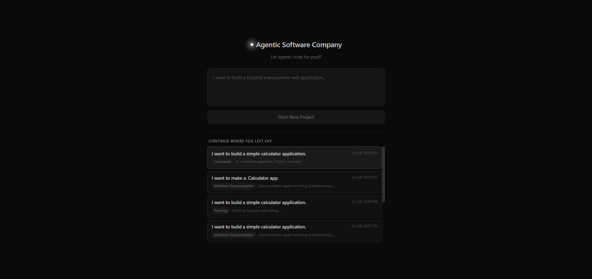
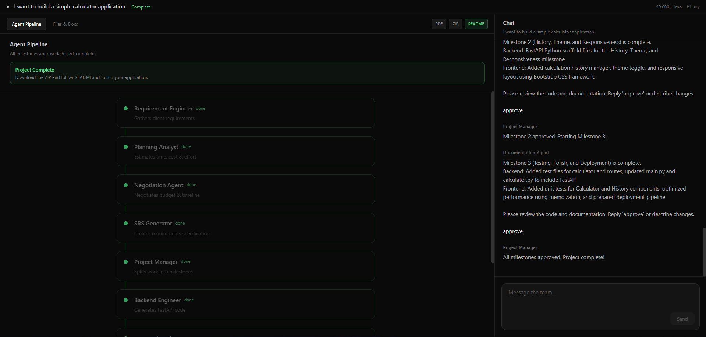
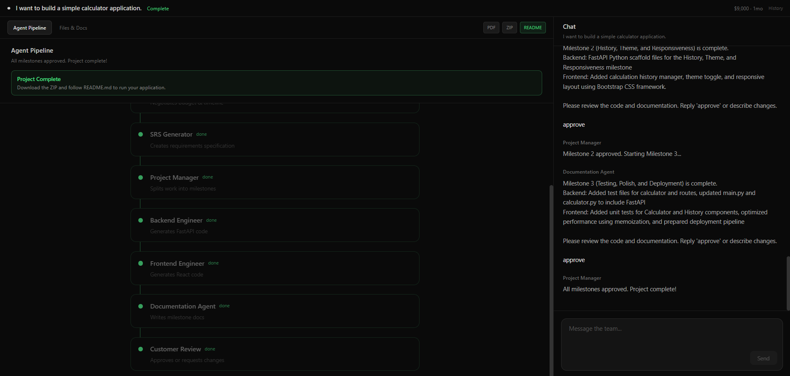
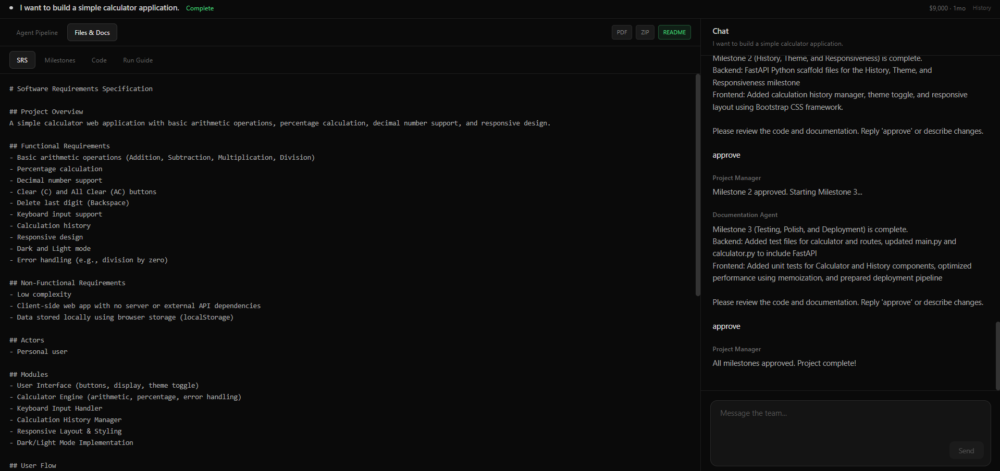
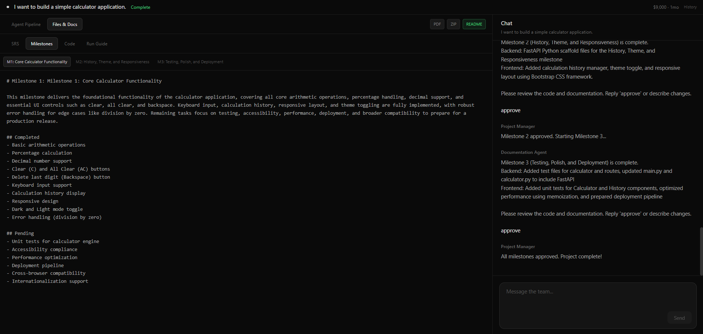
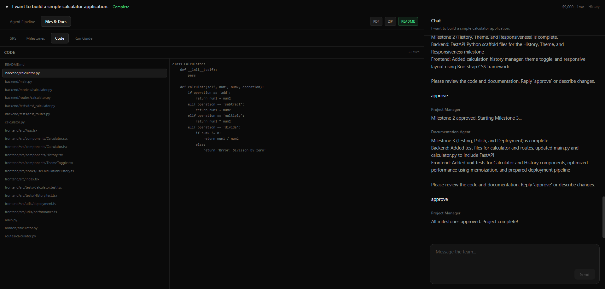
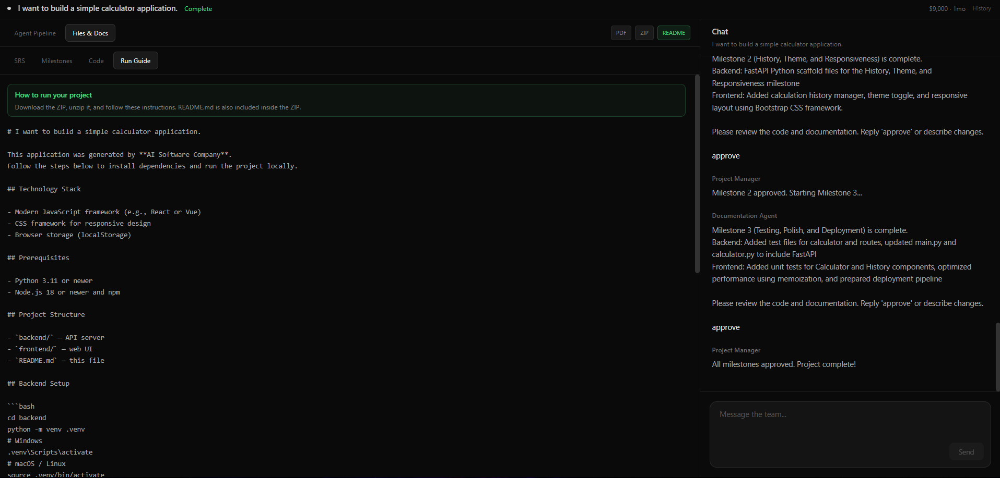

# AI Software Company
This repo is a hands-on capstone: everything I studied in LangChain (models, prompts, structured output, chains/runnables, RAG, tools, agents) wired into one working product. You describe an app idea; a virtual dev team gathers requirements, estimates cost, negotiates, writes an SRS, splits milestones, generates code, documents each milestone, and loops on your approval until the project is done.

**Stack:** Python · FastAPI · LangChain · Groq · React · Vite · Tailwind · Chroma (RAG) · JSON file storage

---

## Demo








---

## User flow
What you do as the customer from start to finish:

```text
                    USER
                      │
                      ▼
             Requirement Analyst
        (Interactive conversation)
                      │
      Ask follow-up questions until requirements are complete
                      │
                      ▼
             Planning Analyst
      (Time, effort & cost estimation)
                      │
                      ▼
            Negotiation Agent
      (Negotiates budget & timeline)
                      │
        Customer accepts proposal
                      │
                      ▼
               SRS Generator
                      │
        Generates complete SRS document
                      │
                      ▼
             Project Manager
      Splits project into milestones
                      │
         ┌────────────┴────────────┐
         ▼                         ▼
 Backend Planning Team      Frontend Planning Team
         │                         │
         └────────────┬────────────┘
                      ▼
          Milestone Documentation Agent
                      │
                      ▼
          Customer reviews milestone
                      │
          Approved? ─── Yes ─────────► Next milestone
               │
               └── No ─► Update milestone
```

**Chat shortcuts**

| When | Type |
|------|------|
| Finish requirements | `done` |
| Accept proposal / milestone | `approve`, `yes done`, `accept` |
| Stuck after error | `continue` |

## Quick start

### Backend

```powershell
cd backend
python -m venv .venv
.\.venv\Scripts\Activate.ps1
pip install -r requirements.txt
uvicorn app.main:app --reload --port 8000
```

### Frontend

```powershell
cd frontend
npm install
npm run dev
```

Open **http://localhost:5173**

Put your Groq key in `.env` at the repo root (see [Environment variables](#environment-variables) below).

## LangChain concepts

This project applies the LangChain topics I studied:

### Models
- **Chat models** — Groq LLMs for every agent (`backend/app/llm/factory.py`)
- **Embeddings** — `FakeEmbeddings` for local Chroma indexing (`backend/app/rag/store.py`)

### Prompts
- **ChatPromptTemplate** — system + human messages per agent (`backend/app/prompts/templates.py`)
- **Message history** — full chat stored on the project and passed into agents

### Outputs
- **Structured output** — Pydantic models for requirements, estimates, SRS, milestones, code bundles (`backend/app/models/`)
- **Output parsers** — `PydanticOutputParser` when native structured output fails on Groq (`backend/app/llm/structured.py`)

### Chains & Runnables
- **RunnableSequence** — SRS → milestone planning → coding pipeline (`backend/app/chains/pipeline.py`)
- **RunnableParallel** — backend + frontend engineers (available; milestone work is stepped for UX)
- **RunnableLambda / RunnableBranch** — phase routing, approve vs revise milestone
- **Stepped advance** — one agent per API call so the frontend can show live progress

### RAG
- **Document loading & text splitting** — SRS and milestone docs chunked (`backend/app/rag/loader.py`)
- **Vector store** — Chroma per project (`backend/app/rag/store.py`)
- **Retriever** — MMR retriever for documentation context (`backend/app/rag/retriever.py`)

### Tools & agents
- **Custom tools** — read/write project files (`backend/app/tools/project_tools.py`)
- **Tool binding** — ReAct-style loops in Requirement Engineer & Negotiation Agent
- **Agent pattern** — specialized agents with their own prompts and outputs (no single monolithic agent)

